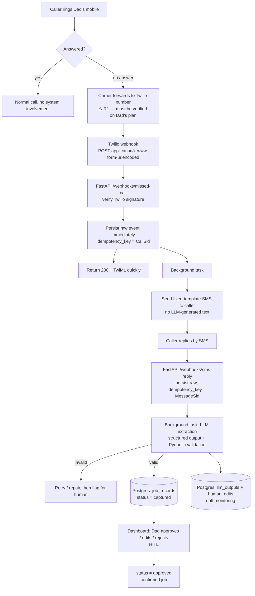

# 05 — Architecture & Schema

## Purpose

Minimal architecture for the missed-call → booked-job MVP. Deliberately boring: one service,
one Postgres, background tasks. Business rationale lives in
[00-business-plan.md](./00-business-plan.md).

## Diagram



**Key ordering (Kleppmann):** persist the raw inbound event **before** any processing, and
return 200 quickly. Twilio retries on timeout, so a slow handler produces duplicates; a
crashed handler loses the job unless the raw event is already stored.

Request-level flows (what happens per HTTP request, step by step, with code anchors):
[11-request-flows.md](./11-request-flows.md).

## Schema

```python
from datetime import datetime
from typing import Literal
from pydantic import BaseModel, Field


class JobRecord(BaseModel):
    # Idempotency (Kleppmann): Twilio retries webhooks, so dedupe on the provider's ID.
    idempotency_key: str = Field(..., description="Twilio CallSid or MessageSid")

    # Trusted fields: sourced from Twilio metadata, NEVER from the LLM.
    caller_number: str = Field(..., description="From Twilio webhook payload, not extracted")
    received_at: datetime

    # Extracted fields: LLM-produced, must be validated and are human-correctable.
    name: str | None = None
    job_type: str | None = None
    location: str | None = None
    urgency: Literal["low", "medium", "high", "unknown"] = "unknown"
    preferred_date: str | None = None

    # Human-in-the-loop (Huyen): nothing is customer-confirmed without approval.
    status: Literal["captured", "needs_review", "approved", "rejected"] = "captured"
    raw_message: str
    extraction_confidence: float | None = None
    created_at: datetime
    updated_at: datetime


class LLMOutputAudit(BaseModel):
    """Every extraction plus the human correction, for drift monitoring (Huyen)."""
    job_id: str
    model: str
    prompt_version: str
    raw_output: str
    validated: bool
    repair_attempts: int = 0
    human_edited: bool = False
    edit_diff: str | None = None
    created_at: datetime
```

> **DB realisation (D-012).** This model is split across two tables: `llm_output_audits`
> (the immutable extraction snapshot: `model`, `prompt_version`, `raw_output`, `validated`,
> `repair_attempts`, keyed to `raw_events.id`, with a nullable `job_id` whose foreign key is
> added in #23) and `human_edits` (one row per correction, linked to `llm_output_audits.id`,
> with `edit_diff` as JSONB rather than a string). `human_edited` is derived — a `human_edits`
> row exists for that output — instead of stored.

## Design decisions

| Decision | Choice | Source / reason |
|---|---|---|
| Web framework | FastAPI, async | Lubanovic — async webhook handling, Pydantic schemas |
| Webhook payload | **`application/x-www-form-urlencoded`** | Confirmed in Twilio's docs: message webhooks are form-encoded. JSON is opt-in and then carries a `bodySHA256` query parameter |
| Webhook security | Verify `X-Twilio-Signature` using Twilio's `RequestValidator`, not hand-rolled HMAC | Otherwise anyone can inject fake jobs. Twilio signs with HMAC-SHA1 over the URL plus all parameters and warns against custom implementations |
| Durability | Persist raw event first, process in background | Kleppmann — survive crashes, avoid lost jobs |
| Idempotency | Unique constraint on `idempotency_key` | Kleppmann — at-least-once delivery means duplicates are normal |
| Queue | FastAPI background task, **no broker** | Kleppmann — no premature distributed complexity |
| Orchestration | LangGraph `StateGraph` + Postgres checkpointer | Explicit branching and `interrupt()`-based HITL; dependency confined to `agents/missed_call` (D-008) |
| Database | Single Postgres (Supabase) | One writer, transactions, no consensus needed |
| LLM output | Structured output + Pydantic validation + repair | Huyen — never trust raw model text |
| Customer-facing SMS | **Fixed template only, never LLM-generated** | Huyen — cap agent autonomy and hallucination blast radius |
| Human approval | Required before any job is "confirmed" | Huyen — HITL on consequential actions |
| Drift monitoring | Log every output + human edit; track edit rate | Huyen — unmonitored drift degrades silently |
| Real-time voice | **Deferred post-MVP** | Latency/cost/complexity; no hypothesis requires it |

## Orchestration: LangGraph

The MVP flow is **linear on paper** (receive → extract → validate → persist → notify → human
review), but it already branches on extraction validity, repair exhaustion and the human
decision, and is expected to become multi-turn. The founder chose LangGraph so the orchestration
model is in place before the flow grows.

- **Decision:** LangGraph `StateGraph`, with a Postgres checkpointer and `interrupt()` for human
  approval. The dependency lives in `agents/missed_call` only; `packages/core` stays
  framework-free. Nodes call plain functions, so business logic stays unit-testable.
- **Consequence:** the LangGraph learning row moves up, ahead of evaluation. G0c item 5 is back
  on the critical path. Checkpoint tables need an Alembic migration.
- **Status:** `accepted` in [D-008](./06-decision-log.md); full reasoning in
  [adr/0001-orchestration-langgraph.md](./adr/0001-orchestration-langgraph.md).

## Risk register

| ID | Risk | Impact | Mitigation | Status |
|---|---|---|---|---|
| **R1** | Carrier will not forward unanswered calls to Twilio with caller ID preserved | **Kills the wedge** | Test on Dad's real plan **before** building (gate G0b) | ⚠️ untested |
| R2 | Callers ignore an SMS from an unknown number | H6 fails | Test early; consider sender identification in the template | open |
| R3 | Extraction accuracy too low to be useful | Rework or stop | Golden set + threshold in Week 3 | open |
| R4 | Free LLM tiers train on customer data | Data-protection breach | Synthetic data only until Week 4; lock one DPA-backed provider (Bedrock preferred) before live traffic (D-009) | mitigated — Bedrock locked (D-018); re-confirm DPA + paid tier at the live gate (#29) |
| R5 | Twilio signature verification skipped under time pressure | Spoofed jobs | Build it in Week 1, not later | open |
| R6 | Silent LLM drift after prompt/model changes | Degrading quality | Audit table + edit-rate metric | open |

## Precursor Ready Check (gate G0c)

1. FastAPI server accepts a **form-encoded** POST webhook and returns a valid response.
2. LLM returns a Pydantic-validated structured object from messy text, with a repair path.
3. Twilio number triggers the webhook on a missed call **on Dad's real carrier**.
4. Write and read a record in Supabase from Python, with a working unique constraint.
5. Build a LangGraph state graph with one conditional branch and a Postgres checkpointer.

## Anti-patterns

- ⚠️ **Premature distributed complexity (Kleppmann).** No Kafka, no microservices, no
  consensus, no multi-region. A solo prototype needs one Postgres and a background task.
- ⚠️ **Non-idempotent webhook consumers (Kleppmann).** Retries are guaranteed; duplicates are
  your problem to absorb.
- ⚠️ **Trusting raw LLM output (Huyen).** Validate, repair, and keep a human on consequential actions.
- ⚠️ **Unmonitored LLM drift (Huyen).** If you are not logging outputs and corrections, you
  cannot see quality degrading.
- ⚠️ **Letting the agent write to customers (Huyen).** Unnecessary autonomy with real reputational cost.
- ⚠️ **Processing before persisting (Kleppmann).** A crash then loses the very job you were trying to capture.

## Open questions

- ~~LangGraph or plain steps for v0?~~ Decided — LangGraph, see D-008 and
  [ADR 0001](./adr/0001-orchestration-langgraph.md).
- Does Dad's carrier support conditional call forwarding to a Twilio number with caller ID?
- ~~Which paid LLM tier provides a suitable UK/EU data-processing agreement?~~ Deferred to
  Week 4 (#29); Bedrock preferred, see D-009 and [ADR 0002](./adr/0002-llm-provider.md).
- SMS sender identity: can messages appear to come from Dad's business name?

## Change history

- **0.5 (2026-11-13)** — R4 marked mitigated: Bedrock locked as the DPA-backed provider (D-018).
- **0.4 (2026-11-05)** — LangGraph accepted (D-008) and orchestration section rewritten; G0c
  item 5 active again; R4 reframed as deferred to the Week 4 DPA lock (D-009); open questions
  resolved.
- **0.3 (2026-11-04)** — orchestration decision documented in ADR 0001 and linked; LLM provider
  and DPA decision documented in ADR 0002 (D-009); R4 mitigation updated; open questions
  resolved or narrowed.
- **0.2 (2026-11-04)** — Mermaid diagram added; Twilio payload corrected to form-encoded;
  persist-before-processing made explicit; idempotency key defined; signature verification
  added; trusted-vs-extracted field split; audit schema added; fixed-template-only customer
  SMS; real-time voice deferred; LangGraph decision opened; risk register added.
- **0.1** — ASCII diagram, JSON webhook assumption, no idempotency or risk register.
