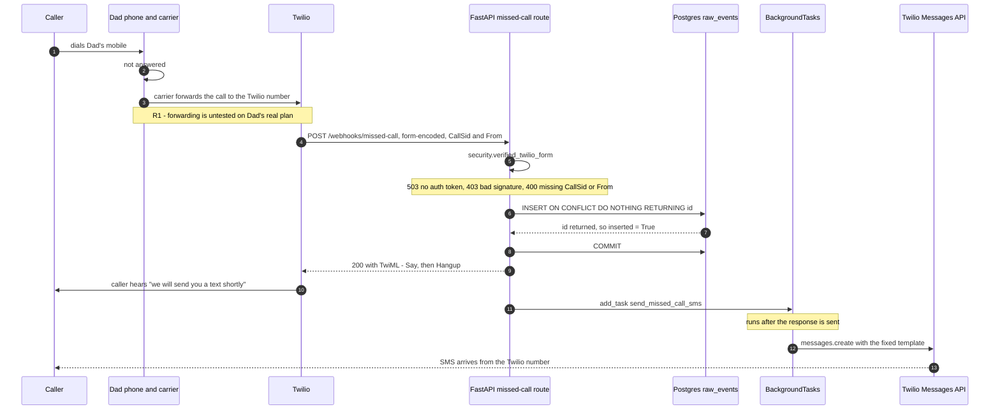
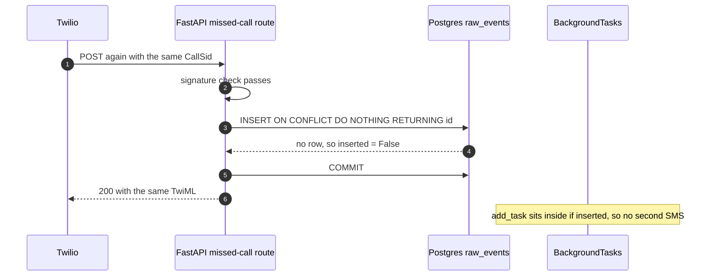
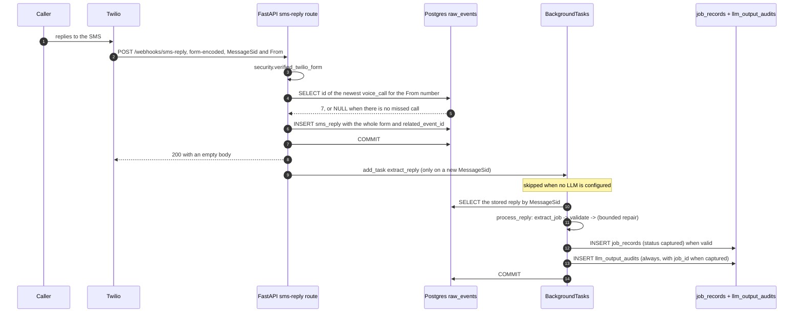
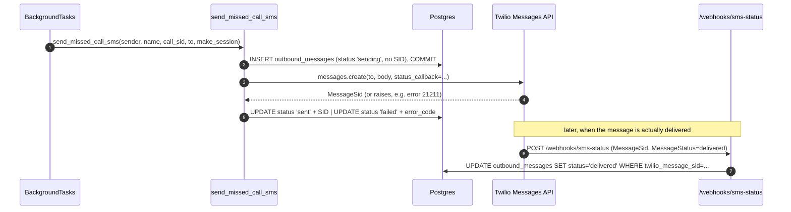
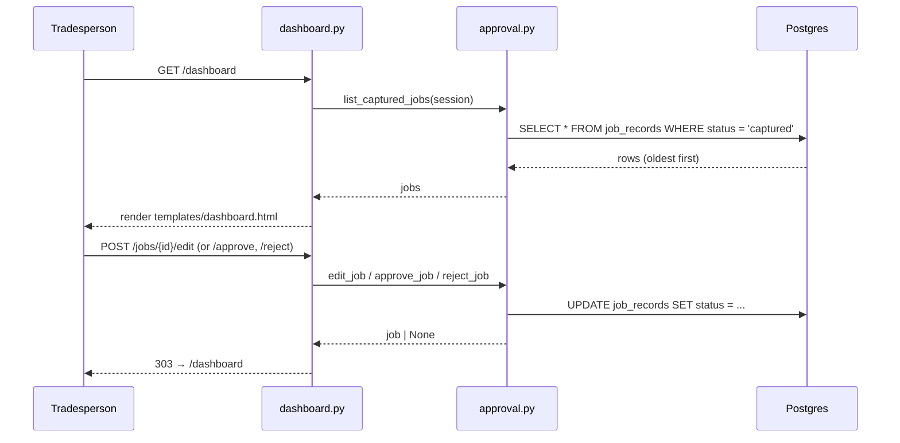
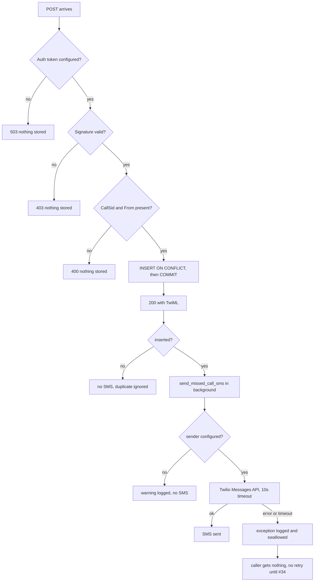
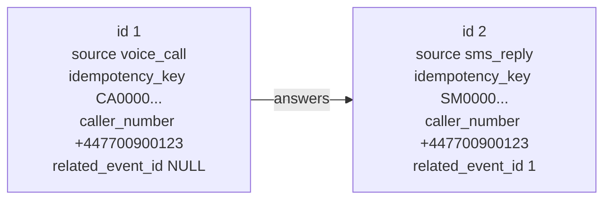

# 11 — Request Flows

## Purpose

What happens, in order, during one HTTP request to the API — which system calls which, what is
written where, and where each step lives in the code. Written for two readers: you, while
walking the code, and a cold agent starting in this repo.

The business-level picture ("what is this system for") is the flowchart in
[05-architecture-and-schema.md](./05-architecture-and-schema.md). This document is the
wire-level companion: Twilio in, SQL out.

Front matter `verified_against` is the commit these diagrams were last checked against. If the
API source has moved since, distrust the diagrams before the code.

## Start here

| Question | Flow | Entry point |
|---|---|---|
| Someone rings and we miss it — what happens? | [Missed call: happy path](#missed-call-happy-path) | `webhooks.py::missed_call` |
| Why doesn't a Twilio retry send a second text? | [Duplicate delivery](#duplicate-delivery) | `idempotency.py::persist_raw_event` |
| The customer replies — what happens? | [SMS reply](#sms-reply) | `webhooks.py::sms_reply` |
| The tradesperson reviews a captured job — what happens? | [Human approval dashboard](#human-approval-dashboard) | `dashboard.py::dashboard` |
| What if the signature is wrong, or Twilio is down? | [Failure paths](#failure-paths) | `security.py`, `sms.py` |
| What does a row actually look like? | [Row shapes](#row-shapes) | `models.py::RawEvent` |

The rule these diagrams encode: **persist → commit → answer → then act.** Everything below is a
consequence of that ordering (AGENTS.md rule 2).

## Missed call: happy path



**Why the order matters, step by step:**

| Order | Step | What breaks if you move it |
|---|---|---|
| 1 | Verify signature | A forged POST becomes a stored job and an SMS to a stranger |
| 2 | INSERT + `RETURNING id` | Without `RETURNING`, "was it new?" is a second race-prone query |
| 3 | `COMMIT` before responding | Twilio is told "stored" while the row is still uncommitted; a crash loses it |
| 4 | Respond `200` | Twilio retries anything that isn't a fast 2xx |
| 5 | `add_task` after the response | A 10s Twilio send inside the request would blow the webhook timeout |
| 6 | Send is wrapped in `try/except` | A send failure must never turn a successful store into a 5xx and a retry |

### Code map

| Step | Symbol |
|---|---|
| Route | `apps/api/src/agent_ant_api/webhooks.py::missed_call` |
| Signature + form parsing | `apps/api/src/agent_ant_api/security.py::verified_twilio_form` |
| Signing URL reconstruction | `apps/api/src/agent_ant_api/security.py::signing_url` |
| Idempotent insert | `packages/core/src/agent_ant_core/db/idempotency.py::persist_raw_event` |
| Transaction boundary | `webhooks.py::missed_call` — the `session.commit()` |
| Session per request | `webhooks.py::get_session` → `db/session.py::get_sessionmaker` |
| TwiML text | `webhooks.py::MISSED_CALL_TWIML` |
| Sender factory | `apps/api/src/agent_ant_api/sms.py::get_sms_sender` |
| Template text | `apps/api/src/agent_ant_api/sms.py::build_missed_call_message` |
| Background send | `apps/api/src/agent_ant_api/sms.py::send_missed_call_sms` |
| Outbound persistence | `packages/core/src/agent_ant_core/db/outbound_sms.py::create_outbound_message` → `models.py::OutboundMessage` |
| Send outcome | `outbound_sms.py::mark_sent`, `::mark_failed` |

### Twilio field → column

| Twilio form field | Becomes | Column |
|---|---|---|
| `CallSid` | idempotency key | `raw_events.idempotency_key` |
| `From` | caller | `raw_events.caller_number` |
| all fields, untouched | raw payload | `raw_events.payload` (JSONB) |
| — | literal | `raw_events.source = 'voice_call'` |
| — | server clock | `raw_events.received_at` |
| — | no parent | `related_event_id = NULL` |

`To` is not promoted to a column. It only matters once there is more than one Twilio number;
until then it lives in `payload`. Adding a column is a migration, so it waits until something
queries it.

## Duplicate delivery

Twilio delivers **at least once**. The same `CallSid` can arrive twice for ordinary reasons: the
200 was lost in transit, the handler was slower than the timeout, or the process died between
`COMMIT` and the response.



Two details worth knowing:

- **Concurrent retries.** If both requests are in flight, the second `INSERT` blocks briefly on
  the first transaction's lock, then sees the conflict and returns zero rows. Postgres decides;
  no Python-level check-then-insert that could race.
- **Both requests return 200.** The duplicate is not an error. Erroring would make Twilio
  retry harder, which is the opposite of what you want.

The guarantee is **at most one text per call, possibly zero** — not exactly one. A send that
fails or a process that dies after `COMMIT` leaves the caller with nothing. That gap is the
outbox in Week 5 (#34).

### Code map

| Step | Symbol |
|---|---|
| The unique key | `models.py::RawEvent.idempotency_key` (`UNIQUE`) |
| Conflict handling | `idempotency.py::persist_raw_event` — `on_conflict_do_nothing` |
| The gate on the send | `webhooks.py::missed_call` — `if inserted:` |
| Race test | `apps/api/tests/test_missed_call_webhook.py::test_retry_does_not_send_a_second_text` |

Dedupe is per **call**, not per caller. A customer who rings twice gets two texts, because those
are two events, not one delivered twice.

## SMS reply

A second, independent webhook. Twilio posts it when the customer replies to the auto-SMS,
seconds or hours later. The only link between the two requests is the database. Storing the
reply is what triggers extraction: a background task reads the stored body and files a job
record (Week 2).



The lookup, which is a heuristic and not a validation:

```sql
SELECT id
FROM raw_events
WHERE source = 'voice_call'
  AND caller_number = '+447700900123'
ORDER BY received_at DESC, id DESC
LIMIT 1;
```

| Outcome | Stored as | Response |
|---|---|---|
| Matching call found | `related_event_id = 7` | 200 |
| No matching call | `related_event_id = NULL` | 200 |
| Duplicate `MessageSid` | not stored | 200 |
| Bad signature | not stored | 403 |

Nothing is rejected for being unlinked. Losing the message would be worse than losing the
association, and the body is needed for extraction either way.

The background task (`extract_reply`) opens its own session: the request's session is closed by
the time the task runs. It re-reads the reply by `MessageSid`, extracts the job (`process_reply`
in `agent_ant_missed_call.processor`), and writes a `job_records` row (status `captured`) plus an
`llm_output_audits` row. A failed extraction writes the audit row only. With no provider
configured the task is skipped entirely, so a reply is still stored and answered.

**STOP / HELP are handled before extraction** (#72, D-019). The route checks the normalised
`Body` against the opt-out and help keywords; a match never reaches the LLM. STOP records the
caller in `opt_outs` and confirms with a fixed one-line text; HELP answers with the fixed
reply-to-here instructions. Both are fixed templates (D-004), sent through the same
`SmsSender`. The opt-out then suppresses future missed-call texts (`missed_call` checks
`opt_outs` before scheduling), but the missed call itself is still stored so the tradesperson
can ring back.

### Code map

| Step | Symbol |
|---|---|
| Route | `webhooks.py::sms_reply` |
| Related-call lookup | `webhooks.py::sms_reply` — the `select(RawEvent.id)` |
| STOP/HELP keyword check | `sms.py::is_stop_keyword`, `::is_help_keyword` |
| Opt-out record | `db/opt_out.py::record_opt_out` → `models.py::OptOut` (`opt_outs`) |
| Opt-out lookup | `db/opt_out.py::is_opted_out` (called from `missed_call`) |
| Insert | `idempotency.py::persist_raw_event` |
| Self-referencing FK | `models.py::RawEvent.related_event_id` |
| Migration | `migrations/versions/…0002…` (`related_event_id`), `…0005…` (`opt_outs`) |
| Provider seam | `extraction.py::get_llm` — returns `LLM \| None` (None until Bedrock lands) |
| Session factory | `extraction.py::get_session_factory` |
| Background task | `extraction.py::extract_reply` |
| Extraction + persistence | `agent_ant_missed_call.processor::process_reply` |
| Job insert | `db/jobs.py::persist_job_record` (idempotent on `idempotency_key`) |

### Twilio field → column

| Twilio form field | Becomes | Column |
|---|---|---|
| `MessageSid` | idempotency key | `raw_events.idempotency_key` |
| `From` | caller | `raw_events.caller_number` |
| `Body`, `To`, `NumMedia`, … | untouched | `raw_events.payload` |
| — | literal | `raw_events.source = 'sms_reply'` |
| — | lookup result | `raw_events.related_event_id` |

`Body` is not its own column: Twilio's field set changes per message, so JSONB absorbs that.
Extraction reads it as `row.payload["Body"]` (or `payload->>'Body'` in SQL).

## Outbound SMS and status callbacks

Every auto-text we send is persisted (D-021), so "did we text this caller, and did it deliver?"
is answerable from our own database, and the reply-rate denominator (H6) is real rather than
guessed. The send happens in the same background task as before, but now writes a row around it.



- The row is written and committed **before** the Twilio call, so a crash cannot leave a "text
  was sent" situation with no record of it.
- A failed send gets `status='failed'` and the Twilio `error_code` (e.g. `21211` = invalid
  number) with no SID; a successful one gets the SID and `status='sent'`.
- The status callback updates by SID, idempotently: a duplicate delivery of the same callback
  just sets the same status again, and an unknown SID is ignored.
- `to` and `body` are personal data, retained 30 days (D-021).

### Code map

| Step | Symbol |
|---|---|
| Route (callback) | `webhooks.py::sms_status` |
| Insert | `db/outbound_sms.py::create_outbound_message` |
| Send outcome | `db/outbound_sms.py::mark_sent`, `::mark_failed` |
| Callback update | `db/outbound_sms.py::apply_status_callback` |
| Reply → text link | `db/outbound_sms.py::find_outbound_for_reply` |
| Model | `models.py::OutboundMessage` (`outbound_messages`) |
| Migration | `migrations/versions/…0006…` |

## Human approval dashboard

The HITL step (rule 6, D-006): nothing counts as confirmed until a human says so. The dashboard
is server-rendered (FastAPI + Jinja2) and lives in the API, not a separate deployable (D-014,
D-005). It has no JSON API and no auth yet — one page, four routes. It also renders the four
business metrics (capture rate, reply rate, jobs booked, edit rate — D-022) at the top, computed
by `agent_ant_core.metrics.compute_metrics`, and a failure panel listing failed/dead SMS sends
(`db/outbound_sms.list_failed_messages`, D-023).



Three actions, one invariant: they only touch jobs whose `status` is `captured`. A job that is
absent or already decided is left alone (the helpers return `None`) and the redirect still lands
back on the dashboard.

- **Approve** (`POST /jobs/{id}/approve`) — mark the captured job `approved` as-is.
- **Reject** (`POST /jobs/{id}/reject`) — mark it `rejected`; not a real job after all.
- **Edit** (`POST /jobs/{id}/edit`) — apply corrections to the editable fields, then approve. A
  form field left empty means "clear the field". The human edit is recorded as a before/after
  diff in `human_edits`, but only for fields that actually changed, so the edit rate counts real
  corrections rather than a full-field echo (R6). The diff is linked to the `llm_output_audits`
  row that produced the job; if there is none, the edit still applies but is not logged.

None of the helpers commit — the route owns the transaction and calls `session.commit()`, the
same boundary as `webhooks.py`.

### Code map

| Step | Symbol |
|---|---|
| Router mount | `main.py::create_app` — `include_router(dashboard_router)` |
| Route (list) | `apps/api/src/agent_ant_api/dashboard.py::dashboard` |
| Route (approve / reject / edit) | `dashboard.py::approve`, `::reject`, `::edit` |
| List captured jobs | `packages/core/src/agent_ant_core/db/approval.py::list_captured_jobs` |
| Approve | `approval.py::approve_job` |
| Reject | `approval.py::reject_job` |
| Edit + approve | `approval.py::edit_job` |
| Human edit diff | `agent_ant_core/audit/records.py::record_human_edit` |
| Template | `apps/api/src/agent_ant_api/templates/dashboard.html` |
| Session per request | `dashboard.py::get_session` → `db/session.py::get_sessionmaker` |

### Editable field → column

| Form field | Editable? | Column |
|---|---|---|
| `name` | yes | `job_records.name` |
| `job_type` | yes | `job_records.job_type` |
| `location` | yes | `job_records.location` |
| `preferred_date` | yes | `job_records.preferred_date` |
| `urgency` | yes (one of `unknown`/`low`/`medium`/`high`) | `job_records.urgency` |
| — | no (trusted field) | `job_records.caller_number` |

Only the five extracted fields are editable. Trusted fields (`caller_number`, timestamps) come
from provider metadata and are never offered for correction — the human is reviewing the LLM's
output, not the inbound record.

## Failure paths



| Failure | Status | Stored | SMS | Twilio retries? |
|---|---|---|---|---|
| `TWILIO_AUTH_TOKEN` unset | 503 | no | no | yes — config error, not transient |
| Missing/wrong signature | 403 | no | no | yes |
| Missing `CallSid` or `From` | 400 | no | no | no |
| Duplicate `CallSid` | 200 | already there | no | no |
| Sender not configured | 200 | yes | no | no |
| Twilio API error or timeout | 200 | yes | no | no |

The last three rows are the important ones: the webhook succeeds even when the text does not.
That is deliberate — a 5xx would make Twilio retry a call that is already stored.

Everything logged on these paths is a SID. Caller numbers are personal data and stay out of
logs (AGENTS.md rule 5).

## Row shapes

What the table looks like after one missed call and one reply:



One relation, self-referencing: `sms_reply.related_event_id → voice_call.id`. A voice call never
points at anything. A reply may point at nothing.

`related_event_id` has no `NOT NULL` and no cascade rules beyond the FK, because the link is a
best guess, not an invariant.

## Anti-patterns

- **Reading these as "exactly one text per call".** It is at most one, possibly zero. See
  [Failure paths](#failure-paths).
- **Adding per-caller suppression to the dedupe key.** "Same event twice" and "two events close
  together" are different questions. Suppression by number is a product decision, not
  idempotency.
- **Putting the LLM call in the webhook.** It belongs after the 200, in a background task, and
  its output is validated before anything is stored as a job.
- **Logging the caller number or the message body** to make debugging easier. SIDs only.
- **Trusting `related_event_id` as proof the reply belongs to that call.** It is the newest call
  from the same number, nothing more.

## Open questions

- **Reply lookup index.** `(source, caller_number, received_at DESC)` when the table grows.
  Sequential scan is fine at MVP volume.
- **Outbox.** Turns "at most one, possibly zero" into "at least once" (#34, Week 5).

## Change history

| Version | Date | Change |
|---|---|---|
| 0.6 | 2026-11-13 | Dashboard now shows the four metrics (D-022) and a failure panel for failed/dead sends (D-023) |
| 0.5 | 2026-11-13 | Added outbound SMS persistence and the status callback route (D-021); resolved the delivery-status open question |
| 0.4 | 2026-11-13 | Added STOP/HELP opt-out to the SMS reply flow (D-019); removed the resolved open question |
| 0.3 | 2026-11-13 | Added human approval dashboard section (four routes, code map, editable-field table) |
| 0.2 | 2026-11-09 | Wired extraction into the SMS reply flow (recorded retroactively) |
| 0.1 | 2026-11-08 | First version: missed call, duplicate delivery, SMS reply, failure paths, row shapes |