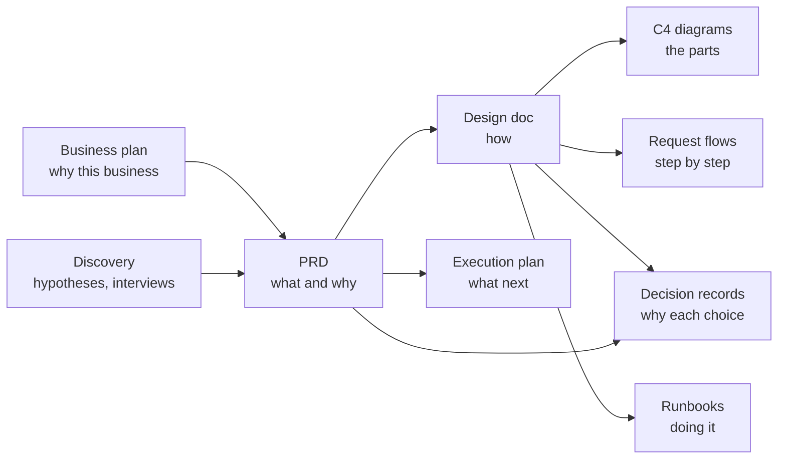

# Trades AI — Documentation

**Trades AI** is a missed-call → booked-job assistant for UK sole traders. When a call goes
unanswered, the caller gets a fixed-template text. Their reply or voicemail becomes a
structured job record, and the trader approves, edits or rejects it. One solo founder works on
it about two hours a day, with a carpenter (Dad) as design partner.

**Where it is now:** the MVP is built but not live. Go-live waits on the discovery gate
(G0a, [#143](https://github.com/Mario8289/agent-ant/issues/143)). The
[execution plan](./planning/execution-plan.md) has the current state.

## Start here

Pick the path that matches why you're here. Each one is about 30 minutes of reading.

| You are… | Read in this order |
|---|---|
| **New to the project** | [PRD](./product/prd.md) → [Design doc](./design/design-doc.md) → [C4 diagrams](./design/c4.md) → [Glossary](./glossary.md) |
| **Writing code** | [AGENTS.md](../AGENTS.md) → [Design doc](./design/design-doc.md) → [Request flows](./design/request-flows.md) → the [decisions](./decisions/README.md) your change touches |
| **Thinking about the business** | [PRD](./product/prd.md) → [Business plan](./product/business-plan.md) → [Hypotheses](./discovery/hypotheses.md) → [Discovery findings](./discovery/findings.md) → [Roadmap](./product/roadmap.md) |
| **Running or deploying it** | [Manual steps](./runbooks/manual-steps.md) → [Design doc §6 Rollout](./design/design-doc.md#6-rollout) → [Forwarding test](./runbooks/telephony-forwarding-test.md) |
| **Asking "why did we…?"** | [Decision records](./decisions/README.md): one file per decision, `D-NNN` |

## How the documents fit together

The **PRD** says what we're building and how we'll know it worked. The **design doc** says how
it's built. **Decision records** explain each choice and what was rejected. Everything else
supports one of those three.

## Map

| Folder | Document | What it is | Status |
|---|---|---|---|
| `product/` | [PRD](./product/prd.md) | Problem, users, goals and metrics, user stories, scope, gates | draft |
| | [Business plan](./product/business-plan.md) | Thesis, competitors, 6-week sprint, kill/continue gates | draft |
| | [Roadmap](./product/roadmap.md) | Agents that might follow `missed_call`, ranked. Planned, not built (D-031) | draft |
| `discovery/` | [Hypotheses](./discovery/hypotheses.md) | Falsifiable assumptions with pass lines committed in advance | draft |
| | [Interview script](./discovery/interview-script.md) | Mom Test discovery interview, no pitching ([printable](./discovery/print/interview-script.pdf)) | draft |
| | [Findings](./discovery/findings.md) | What each interview found, and patterns across them | draft |
| `design/` | [Design doc](./design/design-doc.md) | How it's built: design, data model, interfaces, alternatives, NFRs, risks, rollout, testing | draft |
| | [C4 diagrams](./design/c4.md) | Context, containers, components | draft |
| | [Request flows](./design/request-flows.md) | Sequence diagrams for each webhook, with code anchors | draft |
| `decisions/` | [Decision records](./decisions/README.md) | One file per decision, D-001 onwards | — |
| `runbooks/` | [Manual steps](./runbooks/manual-steps.md) | Console and real-world steps only a person can do | draft |
| | [Forwarding test](./runbooks/telephony-forwarding-test.md) | G0b: set up and test carrier call forwarding | draft |
| `planning/` | [Execution plan](./planning/execution-plan.md) | What to do next, in order, with the gates | draft |
| | [Grants](./planning/grants.md) | When to apply for credits and grants | draft |
| | [Learning track](./planning/learning-track.md) | Skills to learn in order, each with a "done when" test | draft |
| (top level) | [Glossary](./glossary.md) | Plain-English definitions of telephony, product and process terms | draft |

## Where new things go

| You have… | Put it in |
|---|---|
| A decision with a real choice behind it | A new `decisions/D-NNN-slug.md` from the [template](./decisions/template.md) |
| A change to what the product does or who it's for | The [PRD](./product/prd.md), plus a decision if scope changed |
| A change to how it's built | The [design doc](./design/design-doc.md), plus the [C4 diagrams](./design/c4.md) if a part was added, moved or removed |
| A changed route or its ordering | [Request flows](./design/request-flows.md) |
| Steps someone has to do by hand | A section in [manual steps](./runbooks/manual-steps.md), or a new runbook |
| An interview | [Findings](./discovery/findings.md), and the result in [hypotheses](./discovery/hypotheses.md) |

## Status key

- **draft**: not yet tested against evidence
- **validated**: supported by interview or usage data
- **superseded**: replaced, kept for history

## Conventions

- Every doc starts with a front-matter block (status, version, sources).
- Layout: Purpose → Content → Anti-patterns → Open questions → Change history.
- Diagrams are Mermaid so they render on GitHub.
- Links are relative so they work locally and on GitHub.
- Folders group documents by kind. File names have no numbers; the folder says what a doc is.
- Decision records are append-only. A superseded decision is marked, not deleted.

## Change history

- **1.0 (2026-11-17)**: Reorganised into folders by kind, with a PRD, a design doc, C4 diagrams
  and one file per decision (D-032). Added reading paths for each role and "where new things
  go". The verification status moved to the [business plan](./product/business-plan.md).
  "Next actions" was replaced by the [execution plan](./planning/execution-plan.md).
- **0.1 (2026-11-04)**: Created as a numbered index.
