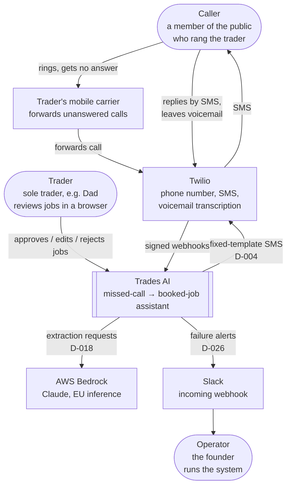
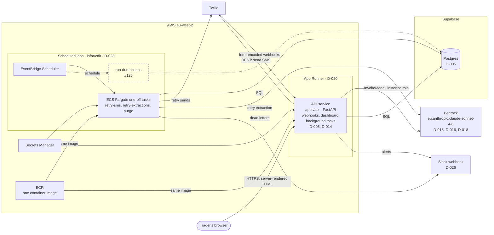
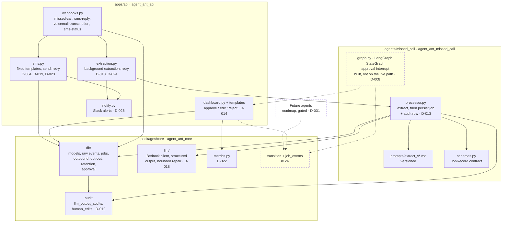

# C4 Diagrams

## Purpose

Pictures of the system at three zoom levels, from the [C4 model](https://c4model.com):
**context** (who and what the system talks to), **containers** (the things we deploy and run)
and **components** (the main parts inside the API). Level 4, code, is not drawn because it would
go stale with every PR. Read the code instead.

The [design doc](./design-doc.md) explains the design; these diagrams are its pictures. For one
request traced step by step, see [request-flows.md](./request-flows.md).

**Legend:** solid boxes are built and on the live path. Dashed boxes are not on the live path:
`graph.py` (built, not wired in), and work that is planned but not built: the lifecycle epic
([#121](https://github.com/Mario8289/agent-ant/issues/121)) and the gated agent roadmap (D-031).
Labels give the decision that put a box there.

**Keep these current.** When a PR adds, removes or moves a container or component, or turns a
planned box into a built one, update the diagram in the same PR.

## Level 1 — System context

Who uses the system and which outside systems it depends on.

**Trust boundary:** only Twilio can create events (signature verified). The only text a caller
ever sees is a fixed template. The trader sees what the LLM produced, and nothing is confirmed
until the trader approves it.

## Level 2 — Containers

What we deploy and run, and how the pieces connect.

- **One image, two runtimes.** The same container runs the API on App Runner and the scheduled
  scripts on Fargate, because App Runner has no cron (D-028).
- **One database.** All state is in one Postgres. There is no broker or cache (D-005).

## Level 3 — Components (inside the API container)

The Python packages inside the image and which way their dependencies point (D-007:
`apps` → `agents` → `packages/core`, never the reverse).

- **Approval logic is in `core`, not the app** (D-014). The app layer only handles HTTP and
  templates.
- **Once #124 lands, only `transition()` writes job state.** Until then the dashboard and the
  extraction path write `job_records` directly through `core/db`.
- **LangGraph stays inside `agents/missed_call`.** `core` is framework-free (D-008). Today
  `processor.py` runs the extraction directly. The graph in `graph.py`, which adds the
  `interrupt()` approval step, is built and tested, but the dashboard approves through `core`
  instead (D-013, D-014). It is drawn dashed until the request path uses it.

## Change history

- **1.0 (2026-11-17)**: Created (D-032). Level 2 comes from the component diagram that was in
  the old doc 05, v0.7. Levels 1 and 3 are new.
