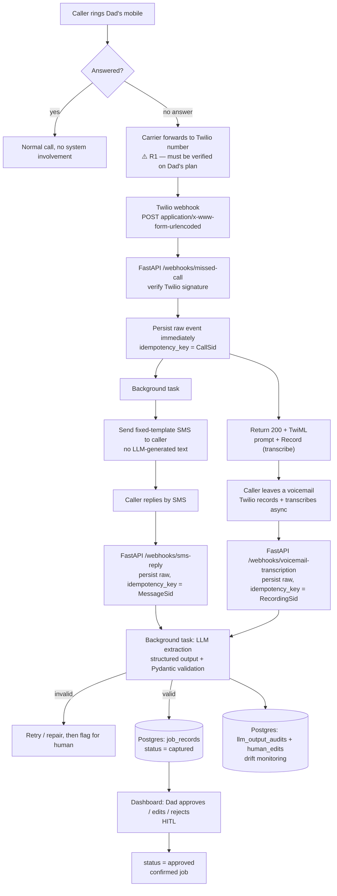

# Design Doc — Missed-call → booked-job MVP

How the MVP is built. What it is for and who it serves is in the [PRD](../product/prd.md).
Why each choice was made is in the [decision records](../decisions/README.md); this doc links to
them rather than repeating them.

**Companion documents:** [C4 diagrams](./c4.md) (the parts) ·
[Request flows](./request-flows.md) (what happens on each webhook, step by step, with code
anchors).

## 1. Context and goals

**Goal.** When a call to a sole trader goes unanswered, the caller gets a fixed-template text,
their reply (or voicemail) becomes a structured job record, and the trader approves, edits or
rejects it. See the [PRD](../product/prd.md) for the user stories and success metrics.

**This design does:**

- Receive Twilio webhooks for missed calls, SMS replies, voicemail transcripts and delivery
  status, verify them, store them, and deduplicate them.
- Send fixed-template SMS (auto-text, STOP confirmation, HELP reply).
- Turn free text into a validated `JobRecord` with an LLM, logging every output for audit.
- Give the trader a server-rendered dashboard to approve, edit or reject jobs.
- Retry failed sends and extractions, alert the operator, and redact personal data on a
  schedule.

**This design does not:**

- Let the LLM write anything a customer sees (D-004).
- Handle real-time voice (D-002), invoicing or payments, or run more than one agent (D-003).
- Use a message broker, microservices or a second database (D-005).

**Design principle:** deliberately boring. One service, one Postgres, background tasks. A
solo founder working about two hours a day has to be able to run it.

## 2. Proposed design

### 2.1 Process



**Key ordering (Kleppmann):** store the raw inbound event **before** any processing, then
return 200 quickly. Twilio retries on timeout, so a slow handler creates duplicates, and a
handler that crashes before storing the event loses the job.

### 2.2 Components

The deployable units and what they talk to are drawn at C4 levels 1–3 in [c4.md](./c4.md). In
short:

| Component | Where | What it does |
|---|---|---|
| API service | `apps/api` on AWS App Runner (D-020) | Webhooks, dashboard, background tasks. One FastAPI process (D-005, D-014) |
| `missed_call` agent | `agents/missed_call` | `processor.py` runs extraction and stores the job and audit row (D-013). Prompts are versioned files. `graph.py` holds the LangGraph approval graph (D-008), which is built but not yet on the request path |
| Core library | `packages/core` | DB access, approval logic, audit, LLM client, metrics. Framework-free |
| Scheduled jobs | `infra/cdk`: EventBridge Scheduler → ECS Fargate (D-028) | `retry-sms`, `retry-extractions`, `purge`, built from the same image as the API |
| Database | Postgres on Supabase (D-005) | All state |
| LLM | AWS Bedrock, `eu.anthropic.claude-sonnet-4-6` (D-015, D-016, D-018) | Extraction only |
| Telephony | Twilio (D-011, D-029) | Forwarded calls, SMS, voicemail transcription |
| Alerts | Slack incoming webhook (D-026) | Operator alerts only, never customer-facing |

Dependencies go one way: `apps` → `agents` → `packages/core` (D-007).

### 2.3 Data model

The Pydantic contract, which is the source the tables are built from:

```python
from datetime import datetime
from typing import Literal
from pydantic import BaseModel, Field


class JobRecord(BaseModel):
    # Idempotency (Kleppmann): Twilio retries webhooks, so dedupe on the provider's ID.
    idempotency_key: str = Field(..., description="Twilio CallSid or MessageSid")

    # Trusted fields: sourced from Twilio metadata, NEVER from the LLM.
    caller_number: str = Field(..., description="From Twilio webhook payload, not extracted")
    received_at: datetime

    # Extracted fields: LLM-produced, must be validated and are human-correctable.
    name: str | None = None
    job_type: str | None = None
    location: str | None = None
    urgency: Literal["low", "medium", "high", "unknown"] = "unknown"
    preferred_date: str | None = None

    # Human-in-the-loop (Huyen): nothing is customer-confirmed without approval.
    status: Literal["captured", "needs_review", "approved", "rejected"] = "captured"
    raw_message: str
    extraction_confidence: float | None = None
    created_at: datetime
    updated_at: datetime


class LLMOutputAudit(BaseModel):
    """Every extraction plus the human correction, for drift monitoring (Huyen)."""
    job_id: str
    model: str
    prompt_version: str
    raw_output: str
    validated: bool
    repair_attempts: int = 0
    human_edited: bool = False
    edit_diff: str | None = None
    created_at: datetime
```

**Tables** (Alembic, `migrations/versions/0001`–`0009`):

| Table | Holds | Decision |
|---|---|---|
| `raw_events` | Every inbound webhook, verbatim, unique `idempotency_key`; extraction attempt state | D-005, D-024 |
| `job_records` | One `JobRecord` per reply or voicemail; unique `idempotency_key` | D-013 |
| `llm_output_audits` | Immutable snapshot of each extraction: model, prompt version, raw output | D-012 |
| `human_edits` | One row per correction, `edit_diff` as JSONB (`field → {before, after}`) | D-012 |
| `outbound_messages` | Every SMS we send, written before the Twilio call, updated by status callback | D-021, D-023 |
| `opt_outs` | Callers who sent STOP | D-019 |

`LLMOutputAudit` is split across `llm_output_audits` and `human_edits` (D-012). `human_edited`
is not stored; it is true when a `human_edits` row exists.

Column-level detail and which Twilio field fills which column are in
[request-flows.md § Row shapes](./request-flows.md).

### 2.4 Interfaces

| Route | Caller | Purpose | Idempotency key |
|---|---|---|---|
| `POST /webhooks/missed-call` | Twilio | Store the call, return TwiML (prompt + record), schedule the auto-text | `CallSid` |
| `POST /webhooks/sms-reply` | Twilio | Store the reply; STOP/HELP handled first; otherwise schedule extraction | `MessageSid` |
| `POST /webhooks/voicemail-transcription` | Twilio | Store the transcript; schedule extraction if transcription completed | `RecordingSid` |
| `POST /webhooks/sms-status` | Twilio | Update `outbound_messages.status` | `MessageSid` (an update, so a repeat is harmless) |
| `GET /dashboard` | Trader | Jobs awaiting review, metrics, failure panels | — |
| `POST /jobs/{id}/approve` · `/reject` · `/edit` | Trader | Human approval; edits write `human_edits` | — |
| `GET /health` · `GET /ready` | App Runner | Liveness; readiness checks the database | — |

All `/webhooks/*` routes verify `X-Twilio-Signature` with Twilio's `RequestValidator`.

**Commands** (`just …`, run on a schedule by D-028): `retry-sms`, `retry-extractions`, `purge`,
plus `erase <number>` on request (D-027).

### 2.5 Data flows

Each webhook is traced step by step, including duplicate deliveries and failure paths, in
[request-flows.md](./request-flows.md). Read that before changing a route or its order.

## 3. Alternatives considered

The main options we turned down. The full reasoning is in each decision record.

| Area | Chosen | Rejected | Why | Record |
|---|---|---|---|---|
| Orchestration | LangGraph `StateGraph` + Postgres checkpointer | Plain functions; Temporal / Hatchet / Prefect; hand-rolled state table | Branching and `interrupt()` approval come with the framework; durable engines need a second service | [D-008](../decisions/D-008-langgraph-orchestration.md) |
| Queueing | FastAPI background tasks | Kafka, SQS, any broker | No premature distributed complexity; raw-event-first gives recovery | [D-005](../decisions/D-005-one-service-one-postgres.md) |
| LLM provider | AWS Bedrock (EU profile) | Anthropic API, OpenAI, Vertex AI | DPA, no-training commitment, UK/EU region, same AWS account | [D-009](../decisions/D-009-swappable-llm-provider.md), [D-018](../decisions/D-018-bedrock-provider-lock.md) |
| Inference geography | `eu.*` cross-region | `eu-west-2` only; `global.*` | More models while data stays in the EU; `global.*` can route to the US | [D-015](../decisions/D-015-eu-cross-region-inference.md) |
| Hosting | App Runner | Vercel, Fargate service, Fly.io, Render, Railway | Background tasks and `interrupt()` need a long-running process; Fly.io and Render are the fallback | [D-020](../decisions/D-020-app-runner-hosting.md) |
| Dashboard | Server-rendered inside the API | Separate SPA / second service | Keeps one service and a Python-only repo | [D-014](../decisions/D-014-dashboard-in-api.md) |
| SMS sender | Twilio number, business named in text | Alphanumeric sender ID; porting Dad's number | Alphanumeric IDs can't receive replies; porting redesigns forwarding | [D-011](../decisions/D-011-sms-sender-twilio-number.md) |
| Opt-out | Handled in our DB | Twilio Advanced Opt-Out | State stays in Postgres; no per-number cost | [D-019](../decisions/D-019-help-stop-opt-out.md) |
| Scheduler | CDK: EventBridge → Fargate | Hand-made console cron | Reviewable and drift-checked | [D-028](../decisions/D-028-cdk-scheduled-jobs.md) |
| Real-time voice | Deferred | Live AI voice agent | Highest-risk component; no hypothesis needs it | [D-002](../decisions/D-002-defer-real-time-voice.md) |

## 4. Non-functional requirements

| Area | Requirement | How it is met |
|---|---|---|
| **Security** | Only Twilio can create events | `X-Twilio-Signature` verified with the SDK on every webhook (R5) |
| | No secrets in the repo or image | `.env` locally; App Runner env vars from Secrets Manager; Bedrock via instance role (D-020) |
| **Trust / safety** | The AI never writes to customers | Fixed templates only (D-004). LLM output goes to the trader |
| | Nothing is confirmed without a human | `approved` is only set from the dashboard (AGENTS rule 6) |
| | Trusted fields never come from the LLM | `caller_number` and timestamps come from Twilio metadata |
| **Privacy** | Personal data processed under a DPA, no training | Bedrock locked with AWS DPA (D-018); synthetic data only until the live gate |
| | Retention limits | Outbound `to`/`body` redacted at 30 days (D-025); raw events and audit output at 90 days; job records kept; erasure on request (D-027) |
| **Reliability** | Duplicate deliveries are harmless | Unique `idempotency_key` on every inbound table |
| | No lead is silently lost | Store first; failed sends and extractions retried 3 times then dead-lettered to the dashboard (D-023, D-024); opt-out suppresses the text, never the record (D-019) |
| **Observability** | The operator hears about failures | Slack alert on send failure and dead letters (D-026); failure panels on the dashboard |
| | LLM drift is visible | Every output audited; edit rate on the dashboard (D-012, D-022) |
| **Performance** | Webhooks answer fast enough that Twilio doesn't retry | Handlers only store and schedule; all slow work runs in background tasks |
| **Cost** | Pennies a month at MVP volume | Bedrock spend guard (SCP + budget action, [manual steps](../runbooks/manual-steps.md)); AWS Activate credits ([grants](../planning/grants.md)) |

## 5. Risks and mitigations

| ID | Risk | Impact | Mitigation | Status |
|---|---|---|---|---|
| **R1** | Carrier will not forward unanswered calls to Twilio with caller ID preserved | **Kills the wedge** | Test on Dad's real plan **before** building (gate G0b) | ⚠️ untested on Dad's plan; passed on a test phone ([runbook](../runbooks/telephony-forwarding-test.md)) |
| R2 | Callers ignore an SMS from an unknown number | H6 fails | Business named in the template (D-011); measure reply rate | open |
| R3 | Extraction accuracy too low to be useful | Rework or stop | Golden set + frozen threshold (D-017) | smoke test passed (H8a); live edit rate decides |
| R4 | Free LLM tiers train on customer data | Data-protection breach | Synthetic data only until the live gate; DPA-backed provider | mitigated: Bedrock locked (D-018); re-confirm DPA + paid tier at go-live (#29) |
| R5 | Twilio signature verification skipped under time pressure | Spoofed jobs | Built in Week 1 | mitigated |
| R6 | Silent LLM drift after prompt/model changes | Degrading quality | Audit tables + edit-rate metric (D-012, D-022) | mitigated; watch edit rate live |

## 6. Rollout

| Stage | What | State |
|---|---|---|
| Weeks 1–3 | Webhooks, auto-text, extraction, golden set and accuracy gate | done |
| Week 4 | Deploy to App Runner (D-020), dashboard, metrics; **Dad goes live, text only** (#31) | built; go-live waiting on the gates |
| Week 5 | Hardening (retries, alerts, retention) and voicemail-to-text | done |
| Week 6 | Live measurement and continue/kill review (#37) | not started |

**Go-live is gated.** Nothing reaches a real customer before G0a, G0b and the Week 4 checks pass
([execution plan](../planning/execution-plan.md)). Before the first real message, re-confirm
the DPA and the paid tier (D-018).

**Deploying:** build one image, push it to ECR, and App Runner deploys it. Run migrations
against Supabase as a separate step first. Scheduled jobs: `just cdk-deploy`. The steps are in
[manual-steps.md](../runbooks/manual-steps.md).

**Rollback:** point App Runner at the previous image tag. Every migration so far only adds
tables, columns or wider constraints, so the previous image runs against the newer schema.
Keep it that way, or the rollback needs `alembic downgrade` first. Scheduled jobs: `cdk deploy` the previous
commit, or `just cdk-destroy` to stop them. Turning off forwarding on the trader's phone stops
all inbound traffic within seconds, so it is the kill switch.

## 7. Testing strategy

| Layer | What | Where | When |
|---|---|---|---|
| Unit | Pure functions, Pydantic contracts, templates, metrics | `*/tests/` | `just test`, every PR (CI) |
| Integration | Webhook → Postgres → background task, idempotency, retries, opt-out | `apps/api/tests/` against Postgres (Docker locally, a service container in CI) | `just test`, every PR (CI) |
| Graph | LangGraph wiring with a fake LLM | `agents/missed_call/tests/` | `just test` |
| Evals | Extraction accuracy on golden sets (`golden_v1` regression, `golden_v2` held-out gate) | `evals/`, `eval` marker | `just eval`, manual GitHub workflow; paid |
| Live | Edit rate, reply rate on real traffic | Dashboard metrics (D-022) | Weeks 4–6 |

Rules: unit tests never call a paid API; anything slow or paid goes behind the `eval` marker. A
change to a prompt or model gets a new prompt version and a golden-set re-run before merge
(D-017, D-018). `just check` (lint, typecheck, test) must pass.

## 8. Open questions

- Does Dad's carrier forward unanswered calls to a Twilio number with caller ID? (G0b, #47, #142)
- Does the wedge survive discovery, or does it move to receipts and paperwork (H9)? (G0a, #143)
- How does a customer set up forwarding without help? The app can't do it for them
  ([runbook](../runbooks/telephony-forwarding-test.md)).
- Twilio region (US1 or IE1) and the Twilio DPA: decide before go-live.

## Anti-patterns

- ⚠️ **Premature distributed complexity (Kleppmann).** No Kafka, no microservices, no
  consensus, no multi-region. A solo prototype needs one Postgres and a background task.
- ⚠️ **Non-idempotent webhook consumers (Kleppmann).** Retries are guaranteed. Duplicates
  have to be absorbed.
- ⚠️ **Trusting raw LLM output (Huyen).** Validate, repair, and keep a human on consequential actions.
- ⚠️ **Unmonitored LLM drift (Huyen).** If outputs and corrections aren't logged, nobody can
  see quality getting worse.
- ⚠️ **Letting the agent write to customers (Huyen).** Unnecessary autonomy with real reputational cost.
- ⚠️ **Processing before persisting (Kleppmann).** A crash then loses the very job you were trying to capture.

## Change history

- **1.0 (2026-11-17)**: Renamed from "05 — Architecture & Schema" and reshaped into a design
  doc (D-032). Added context and goals, interfaces, alternatives considered, non-functional
  requirements, rollout and testing strategy. The component diagram moved to [c4.md](./c4.md).
  The design-decisions table became Alternatives + NFRs. The Precursor Ready Check (G0c) moved
  to the [execution plan](../planning/execution-plan.md). Risk statuses updated.
- **0.7 (2026-11-17)**: Added a component diagram: built services solid, the lifecycle work
  from #121 dashed, future agents as one gated box. Quoted the TwiML label in the process
  diagram so Mermaid renders it.
- **0.6 (2026-11-14)**: Added the voicemail-to-text capture path (D-029): the missed-call TwiML
  now prompts for a message and Twilio transcribes it into the same extraction pipeline.
- **0.5 (2026-11-13)**: R4 marked mitigated: Bedrock locked as the DPA-backed provider (D-018).
- **0.4 (2026-11-05)**: LangGraph accepted (D-008) and orchestration section rewritten; G0c
  item 5 active again; R4 reframed as deferred to the Week 4 DPA lock (D-009); open questions
  resolved.
- **0.3 (2026-11-04)**: orchestration decision documented in D-008 and linked; LLM provider
  and DPA decision documented in D-009; R4 mitigation updated; open questions
  resolved or narrowed.
- **0.2 (2026-11-04)**: Mermaid diagram added; Twilio payload corrected to form-encoded;
  persist-before-processing made explicit; idempotency key defined; signature verification
  added; trusted-vs-extracted field split; audit schema added; fixed-template-only customer
  SMS; real-time voice deferred; LangGraph decision opened; risk register added.
- **0.1**: ASCII diagram, JSON webhook assumption, no idempotency or risk register.
